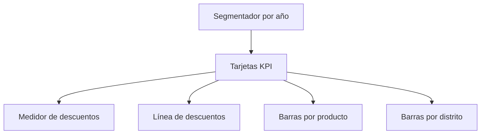

# Informe DNX Cauchos
> **Fuentes y límites de verificación.** El texto se basa en archivos aportados por el equipo. Las capturas de SSMS del informe Word provienen del documento de experimentación compartido; los diagramas de esta versión web son reconstrucciones. No se simulan capturas de Power BI Desktop ni de una ejecución SQL no realizada.

Documentación del dashboard Power BI

Estructura de página, visuales, métricas y flujo de actualización

| Componente | Power BI |
| --- | --- |

| Base de trabajo | Archivos adjuntos de DNX Cauchos S.R.L. |
| --- | --- |

| Evidencia | Archivos originales, metadatos PBIX y exportaciones CSV |
| --- | --- |

### Alcance

Se describen los procedimientos y resultados sustentados en los archivos entregados. Los gráficos elaborados a partir de datos y los esquemas reconstruidos se identifican como tales; no se presentan como capturas de una sesión ejecutada en SQL Server o Power BI.

*Fuentes principales: DNX_Cauchos_Dashboard.pbix, Hecho_ventas(1).csv, dim_tiempo(1).csv, dim_producto(1).csv, dim_metodoPago(1).csv.*

## 1. Objetivo

Mostrar indicadores de ventas completadas de DNX Cauchos mediante una página de Power BI con filtro por año, tarjetas de rendimiento, meta de descuentos y análisis por producto y distrito. El archivo examinado es DNX_Cauchos_Dashboard.pbix adjuntado en esta conversación.

## 2. Contenido técnico del archivo PBIX

El archivo contiene una definición de reporte con una página llamada «Página 1», tamaño 1920 × 1080, y ocho objetos visuales. La información se extrajo de los archivos de definición internos del PBIX, sin afirmar que el reporte haya sido abierto y actualizado en Power BI Desktop.

**Figura 1. Distribución reconstruida a partir de los metadatos de posición de los ocho visuales.**

| Objeto visual | Campos o medidas identificados |
| --- | --- |

| Segmentador | dim_tiempo.anio |
| --- | --- |

| Tarjetas KPI | Ventas Netas; Utilidad Total; Margen %; Numero de Ventas; Unidades Vendidas |
| --- | --- |

| Medidor | Descuento Total; Meta Descuento; Maximo Medidor |
| --- | --- |

| Tarjetas de descuento | Estado Descuento; Descuento Total; % Consumo Meta; Saldo Descuento |
| --- | --- |

| Gráfico de líneas | dim_tiempo.mes; Descuento Acumulado; Meta Descuento |
| --- | --- |

| Barras por producto | dim_producto.nombre_producto; Ventas Netas |
| --- | --- |

| Barras por distrito | dim_cliente.distrito; Ventas Netas |
| --- | --- |

| Cuadro de texto | Título o texto del reporte |
| --- | --- |

*Tabla 1. Objetos presentes en Report/definition/.../visual.json.*

## 3. Procedimiento para abrir y actualizar

Abrir el archivo DNX_Cauchos_Dashboard.pbix en Power BI Desktop.

En «Transformar datos» o «Configuración de origen de datos», confirmar el servidor y la base de datos referenciada.

Revisar la existencia de hecho_ventas y de las dimensiones, su tipo de dato y las cardinalidades de las relaciones.

Actualizar los datos. No continuar con el análisis si aparecen errores de conexión o correspondencias de clave.

Revisar el año del segmentador, el total de KPI y los gráficos de descuentos, productos y distritos.

Captura pendiente: [Insertar una captura real de Power BI Desktop con Página 1 abierta y la última fecha de actualización]. La figura 1 es un esquema reconstruido, no la pantalla real.

## 4. Conceptos de cálculo

Se reconocen nombres de medidas DAX en el PBIX, pero la definición exacta de todas las fórmulas no queda documentada únicamente por la disposición de los visuales. Las siguientes expresiones son criterios de comparación para revisar el modelo y no reemplazan el DAX original.

Ventas netas de control = SUM(hecho_ventas[total_venta])

Utilidad de control = SUM(hecho_ventas[utilidad])

Margen de control = DIVIDE([Utilidad de control], [Ventas netas de control])

Ventas distintas de control = DISTINCTCOUNT(hecho_ventas[pk_venta])

## 5. Resultados de referencia en CSV

| Indicador de control | Resultado CSV sin filtros |
| --- | --- |

| Ventas netas | S/ 4,816,594.00 |
| --- | --- |

| Utilidad | S/ 298,346.50 |
| --- | --- |

| Margen estimado | 6.19 % |
| --- | --- |

| Número de ventas distintas | 1,406 |
| --- | --- |

| Unidades vendidas | 256,705 |
| --- | --- |

| Descuentos | S/ 70,370.00 |
| --- | --- |

*Tabla 2. Totales calculados en Hecho_ventas(1).csv; no son una lectura en vivo del PBIX.*

**Figura 2. Datos CSV por año después de relacionar id_tiempo; faltan 2 detalles sin fecha dimensional.**

*La captura original o el gráfico derivado se encuentra en la edición ilustrada del informe.*

## 6. Interpretación de los gráficos

Tarjetas KPI: resumen de ventas y rentabilidad. Verificar que «Numero de Ventas» cuente cabeceras distintas y no líneas de detalle.

Medidor y estado de descuentos: comparar el valor acumulado con la meta definida en el modelo y documentar si es anual o global.

Línea de descuento acumulado: validar el orden de los meses y el comportamiento al aplicar el filtro anual.

Barras por producto y distrito: verificar que no desaparezcan importes por claves sin correspondencia.

## 7. Reglas para interpretar datos

La tabla hecho_ventas solo incorpora ventas de estado COMPLETADO. Los pedidos PENDIENTE o CANCELADO no aparecen en esas medidas y requieren un modelo adicional de cabeceras para analizar estados. No debe tratarse el filtro de hechos completados como una medición de todos los pedidos.

> **Riesgo observado:** En las exportaciones recibidas hay claves de métodos de pago, producto, vendedor y tiempo sin correspondencia; deben revisarse antes de interpretar filtros y desgloses del reporte como definitivos.

## 8. Evidencia para la entrega

[Captura del panel de relaciones, con dirección y cardinalidad].

[Captura de medidas DAX en el panel de datos].

[Captura de la página completa y su filtro por año].

[Capturas de comparaciones de KPI con las consultas SQL de la misma carga].

## Anexo A. Consideraciones para el modelo de relaciones

Las dimensiones CSV preparadas para Big Data contienen repeticiones deliberadas x400. No deben importarse directamente como lado «uno» de una relación sin depurar; Power BI podría rechazar la cardinalidad o introducir ambigüedad. El PBIX debe conectarse al Data Mart SQL de la misma versión validada.

| Elemento | Comprobación previa a publicar |
| --- | --- |

| dim_cliente | CSV exportado sin id_cliente; comprobar clave real en el modelo Power BI |
| --- | --- |

| dim_producto | 60 códigos originales repetidos hasta 24,000 filas de prueba |
| --- | --- |

| dim_vendedor | 60 códigos originales repetidos hasta 24,000 filas de prueba |
| --- | --- |

| dim_tiempo | Verificar integridad de id_tiempo y orden de meses |
| --- | --- |

| hecho_ventas | Una fila por pk_detalle; medida de ventas usa DISTINCTCOUNT(pk_venta) |
| --- | --- |

| Metas de descuento | Documentar umbral DAX, periodo y semáforo exactos |
| --- | --- |
