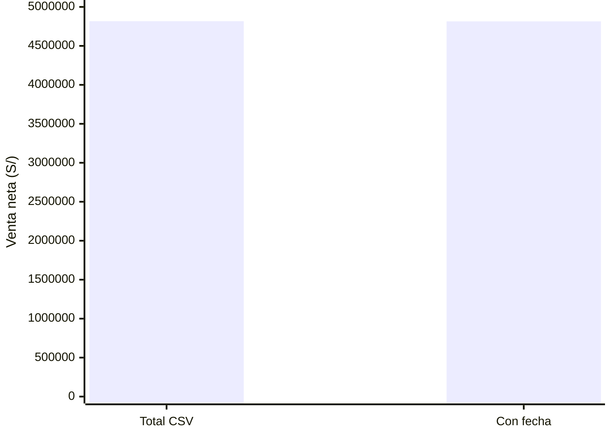

# Experimentación y validación de Power BI

> **Fuentes y límites de verificación.** El texto se basa en archivos aportados por el equipo. Las capturas de SSMS del informe Word provienen del documento de experimentación compartido; los diagramas de esta versión web son reconstrucciones. No se simulan capturas de Power BI Desktop ni de una ejecución SQL no realizada.

Pruebas numéricas, filtros por año e integridad del modelo

| Componente | Experimentación Power BI |
| --- | --- |

Base de trabajo · Archivos adjuntos de DNX Cauchos S.R.L.

| Evidencia | Archivos originales, metadatos PBIX y exportaciones CSV |
| --- | --- |

### Alcance

Se describen los procedimientos y resultados sustentados en los archivos entregados. Los gráficos elaborados a partir de datos y los esquemas reconstruidos se identifican como tales; no se presentan como capturas de una sesión ejecutada en SQL Server o Power BI.

*Fuentes principales: DNX_Cauchos_Dashboard.pbix, Hecho_ventas(1).csv, dim_tiempo(1).csv, dim_producto(1).csv, dim_metodoPago(1).csv.*

## 1. Objetivo e hipótesis

Comprobar que los resultados visibles del dashboard pueden conciliarse con el Data Mart y que los filtros no pierden registros por errores en las relaciones. Se utiliza el archivo PBIX para identificar visuales y los CSV para calcular resultados independientes. La ejecución interactiva en Power BI Desktop queda señalada como pendiente.

## 2. Diseño de la prueba

| ID | Prueba |
| --- | --- |

| PBI-01 | Totales sin filtros |
| --- | --- |

| PBI-02 | Filtro por año | El total por año coincide con el agregado de hechos asociados a calendario |
| --- | --- | --- |

| PBI-03 | Descuento acumulado | Suma y secuencia mensual explicables; meta correctamente definida |
| --- | --- | --- |

| PBI-04 | Segmentación por dimensiones | Ninguna línea de hecho queda excluida por clave ausente |
| --- | --- | --- |

| PBI-05 | Conteo de operaciones | DISTINCTCOUNT(pk_venta), no COUNT(*) |
| --- | --- | --- |

*Tabla 1. Plan de pruebas y resultados a verificar en Power BI Desktop.*

## 3. Prueba PBI-01: indicadores generales

El procesamiento directo del CSV de hechos permite construir una línea base cuantitativa. Los importes tienen precisión a dos decimales y proceden de las columnas ya calculadas del Data Mart.

Campo o KPI · Resultado de control

SUM(total_venta) · S/ 4,816,594.00

SUM(utilidad) · S/ 298,346.50

SUM(descuento) · S/ 70,370.00

SUM(cantidad) · 256,705

COUNT(*) de líneas · 2,828

DISTINCTCOUNT(pk_venta) · 1,406

*Tabla 2. Valores de control medidos en Hecho_ventas(1).csv.*

> **Estado:** Validado sobre el CSV. Falta verificar en el PBIX abierto que las fórmulas DAX y filtros devuelven exactamente esos importes para esta misma carga.

## 4. Prueba PBI-02: contexto del calendario

Al cruzar hecho_ventas.csv con dim_tiempo.csv por id_tiempo, dos líneas carecen de correspondencia porque los hechos contienen id_tiempo = 1 y la dimensión empieza en 2. Su venta neta conjunta es S/ 2,277.50.

**Figura 1. Diferencia entre suma total del CSV y suma vinculada a calendario por ID.**

Agregación · Venta neta

CSV completo · S/ 4,816,594.00

Con dimensión tiempo disponible · S/ 4,814,316.50

Diferencia excluida · S/ 2,277.50

*Tabla 3. Reconstrucción en Python; no son capturas de un filtro ejecutado en Power BI.*

## 5. Prueba PBI-04: integridad del modelo

**Figura 2. Comprobación independiente de ID contra claves presentes en los CSV dimensionales.**

*La captura original o el gráfico derivado se encuentra en la edición ilustrada del informe.*

Las líneas de hechos sin correspondencia son 805 para método de pago, 39 para vendedor, 33 para producto y 2 para tiempo. Una misma fila puede presentar más de un fallo. En total, 857 filas presentan al menos una clave ausente entre esas cuatro dimensiones. Sus ventas netas suman S/ 1,460,725.50; eso no implica que Power BI pierda toda esa cifra siempre, sino que existe riesgo de exclusión según las relaciones y los campos utilizados.

## 6. Prueba PBI-05: nivel de detalle

La tabla de hechos posee 2,828 líneas, pero solo 1,406 ventas distintas. Si una tarjeta cuenta filas como «Número de ventas», exagerará el número de operaciones. La comprobación correcta usa la clave pk_venta para contar operaciones únicas.

`Numero de ventas de control = DISTINCTCOUNT(hecho_ventas[pk_venta])`
`Lineas de venta de control = COUNTROWS(hecho_ventas)`
## 7. Ensayo funcional pendiente en Power BI Desktop

**Figura 3. Estructura real de visuales reconstruida desde el PBIX; usarla como guía para capturas de prueba.**

*La captura original o el gráfico derivado se encuentra en la edición ilustrada del informe.*

Abrir el PBIX con la carga CSV/SQL coincidente y registrar los valores de las cinco tarjetas iniciales sin filtros.

Aplicar «2025» y «2026» en el segmentador anio, capturar los resultados y compararlos con la consulta SQL equivalente.

Comprobar la línea de descuentos por mes y confirmar la fórmula DAX de acumulado y la definición de Meta Descuento.

Filtrar un producto y un distrito conocidos; inspeccionar si existen elementos en blanco debido a filas sin dimensión.

Corregir y recargar las claves, repetir las mismas capturas y dejar una tabla ANTES/DESPUÉS.

## 8. Resultados y conclusiones

Prueba · Resultado actual

PBI-01 · Control CSV calculado; ejecución PBIX pendiente

PBI-02 · 2 detalles sin fecha; diferencia S/ 2,277.50 en cruce de CSV

PBI-03 · Definición de medidas identificada; fórmula exacta y ejecución pendientes

PBI-04 · 857 filas con clave faltante en al menos una de 4 dimensiones

PBI-05 · 2,828 líneas frente a 1,406 ventas distintas

*Tabla 4. Estado comprobado, separado de pruebas por ejecutar.*

Los datos aportados permiten demostrar que la correspondencia de claves condiciona los desgloses y filtros de Power BI. El siguiente experimento debe ejecutarse con una única versión de las bases de datos, documentando conexiones, medidas DAX, capturas antes y después y resultados reconciliados con SQL Server.

Evidencias pendientes: [Captura real del dashboard sin filtros], [capturas 2025/2026], [captura DAX de medidas], [resultado SQL Server sobre la misma carga], [captura del modelo y relaciones].

## Anexo A. Plantilla de captura y comparación final

La siguiente matriz debe llenarse durante una sesión real de Power BI Desktop. Hasta entonces, las pruebas del PBIX siguen como pendientes, aunque el cálculo externo desde CSV esté completado.

| Captura real requerida | Dato que debe registrarse | Comparación |
| --- | --- | --- |

| Vista sin filtros | 5 tarjetas KPI y medidor de descuento | Totales de SQL Server o CSV conciliado |
| --- | --- | --- |

| Filtro 2025 | Ventas, utilidad, descuentos y registros | Consulta agrupada por año |
| --- | --- | --- |

| Filtro 2026 | Ventas, utilidad, descuentos y registros | Consulta agrupada por año |
| --- | --- | --- |

| Relaciones del modelo | Claves, cardinalidad y dirección de filtro | 0 claves sin correspondencia |
| --- | --- | --- |

| Panel de medida DAX | Fórmulas exactas de KPI y meta | Revisar granulación y contextos |
| --- | --- | --- |

| Vista tras corregir claves | Importes antes/después de la recarga | Brecha explicada y documentada |
| --- | --- | --- |
