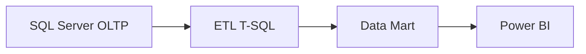
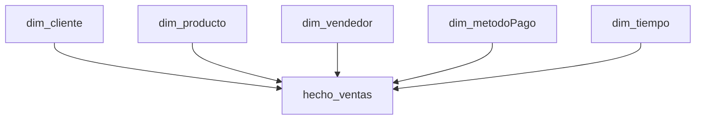

# Documentación de SQL Server, ETL y Data Mart

> **Fuentes y límites de verificación.** El texto se basa en archivos aportados por el equipo. Las capturas de SSMS del informe Word provienen del documento de experimentación compartido; los diagramas de esta versión web son reconstrucciones. No se simulan capturas de Power BI Desktop ni de una ejecución SQL no realizada.

Creación, modelo dimensional, flujo de carga y validación

| Componente | SQL Server · ETL · Data Mart |
| --- | --- |

Base de trabajo · Archivos adjuntos de DNX Cauchos S.R.L.

Evidencia · Archivos originales, metadatos PBIX y exportaciones CSV

### Alcance

Se describen los procedimientos y resultados sustentados en los archivos entregados. Los gráficos elaborados a partir de datos y los esquemas reconstruidos se identifican como tales; no se presentan como capturas de una sesión ejecutada en SQL Server o Power BI.

*Fuentes principales: Base de datos Transaccional DNX Cauchos SRL(1).sql, Base de datos Análitica DataMart DNX Cauchos SRL(1).sql, Base de datos proceso ETL DNX Cauchos SRL(1).sql.*

## 1. Objetivo y alcance

Describir la construcción de dos bases de datos en SQL Server: una transaccional que almacena ventas de suelas y otra analítica que consolida información por cliente, producto, vendedor, tiempo y método de pago. El objetivo del ETL es trasladar los detalles de ventas completadas al modelo dimensional.

**Figura 1. Flujo técnico reconstruido a partir de los scripts SQL y del archivo PBIX.**

## 2. Requisitos y preparación

Microsoft SQL Server y SQL Server Management Studio (SSMS), con permisos para crear bases de datos y ejecutar comandos DELETE/DBCC.

Una instancia de prueba con las bases dbo_DNX_Cauchos_SRL (origen) y dm_DNX_Cauchos_SRL (analítica).

Conservar el orden de ejecución y comprobar qué versión del archivo transaccional corresponde al conjunto de CSV que se está analizando.

> **Control de versiones:** El archivo transaccional (1) adjunto contiene 75 identificadores CLI, 60 PRO, 12 VEN, 360 VNT y 470 DET; los CSV ampliados recibidos corresponden a una carga de mayor escala. No se deben mezclar sus recuentos.

## 3. Base de datos transaccional

El esquema contiene seis tablas relacionadas. Venta almacena el estado y los identificadores del cliente, vendedor y método de pago. DetalleVenta contiene los productos de cada transacción, cantidad, precio unitario y descuento.

| Tabla | Clave principal | Uso |
| --- | --- | --- |

| Cliente | id_cliente | Identificación, tipo y distrito |
| --- | --- | --- |

| Producto | id_producto | Suela, material, stock, precio y costo |
| --- | --- | --- |

| Vendedor | id_vendedor | Personal comercial |
| --- | --- | --- |

| MetodoPago | id_metodo_pago | Tipo y denominación del pago |
| --- | --- | --- |

| Venta | id_venta | Cabecera, fecha y estado |
| --- | --- | --- |

| DetalleVenta | id_detalle | Producto, cantidad, precio y descuento |
| --- | --- | --- |

*Tabla 1. Tablas transaccionales verificadas en el script.*

## 4. Diseño del Data Mart

**Figura 2. Esquema estrella reconstruido a partir de las claves foráneas del DDL.**

La tabla hecho_ventas contiene una fila por detalle de venta completada. Sus claves subrogadas enlazan con dim_cliente, dim_producto, dim_vendedor, dim_metodoPago y dim_tiempo. Además conserva pk_venta y pk_detalle del sistema de origen para trazabilidad.

| Medida | Cálculo SQL | Interpretación |
| --- | --- | --- |

| monto_venta | cantidad × precio_unitario | Venta bruta del detalle |
| --- | --- | --- |

| total_venta | monto_venta − descuento | Venta neta del detalle |
| --- | --- | --- |

| costo_total | cantidad × costo_fabricacion | Costo de fabricación estimado |
| --- | --- | --- |

| utilidad | total_venta − costo_total | Margen monetario antes de gastos externos |
| --- | --- | --- |

*Tabla 2. Medidas definidas en hecho_ventas.*

## 5. Proceso de extracción, transformación y carga

Se vacían primero hecho_ventas y luego las dimensiones para evitar conflictos por claves foráneas.

Se insertan las dimensiones de cliente, producto, vendedor y método de pago leyendo las tablas del origen.

Se genera dim_tiempo recorriendo el intervalo desde MIN(fecha) hasta MAX(fecha) de Venta.

La carga de hechos cruza Venta, DetalleVenta, Producto y las cinco dimensiones por códigos de negocio, calcula importes y filtra V.estado = COMPLETADO.

**Figura 3. Extracto del archivo ETL entregado: inserción a la tabla de hechos; representación visual del texto fuente.**

*La captura original o el gráfico derivado se encuentra en la edición ilustrada del informe.*

## 6. Orden recomendado de ejecución

| Orden | Archivo | Resultado esperado |
| --- | --- | --- |

| 1 | Base de datos Transaccional ... (1).sql | Crea esquema y carga datos del origen de esa versión |
| --- | --- | --- |

| 2 | Base de datos Análitica DataMart ... (1).sql | Crea cinco dimensiones y hecho_ventas |
| --- | --- | --- |

| 3 | Base de datos proceso ETL ... (1).sql | Recarga datos y ejecuta consultas de validación |
| --- | --- | --- |

*Tabla 3. Secuencia de trabajo en una instancia de pruebas.*

> **Precaución:** Los scripts CREATE DATABASE no son idempotentes. En la versión ETL aportada, DBCC CHECKIDENT(... RESEED, 1) después de DELETE hace que el siguiente IDENTITY(1,1) empiece en 2; para iniciar en 1 corresponde RESEED, 0 en tablas no truncadas.

## 7. Validación y evidencia

La sección final del ETL compara el conteo de detalles completados del origen con hecho_ventas y calcula SUM(total_venta), SUM(cantidad), SUM(descuento), SUM(costo_total) y SUM(utilidad). Para cerrar la validación deben conservarse capturas del árbol de tablas, conteos antes/después y resultados del ETL obtenidos en SSMS.

`SELECT COUNT(*) AS lineasOLTP`
`FROM dbo_DNX_Cauchos_SRL.dbo.Venta v`
`JOIN dbo_DNX_Cauchos_SRL.dbo.DetalleVenta d ON d.id_venta = v.id_venta`
`WHERE v.estado = 'COMPLETADO';`
`SELECT COUNT(*) AS lineasDataMart FROM dm_DNX_Cauchos_SRL.dbo.hecho_ventas;`
> **Evidencia pendiente:** [Captura real de la ejecución exitosa del ETL en SSMS, con fecha, servidor de pruebas y resultados]. No se suplanta con una imagen generada.

## 8. Limitaciones

No hay staging físico ni carga incremental; la implementación utiliza una recarga completa.

La utilidad no incluye impuestos ni gastos administrativos; se calcula contra costo de fabricación.

La tabla de hechos excluye operaciones pendientes y canceladas; para analizarlas hay que consultar la cabecera de Venta.

Las exportaciones CSV observadas no deben atribuirse al script transaccional (1) sin validar que provienen de esa misma versión.

## Anexo A. Matriz de comprobación para la ejecución

Para demostrar la reproducibilidad del proyecto, cada corrida debe registrar fecha, versión de scripts y resultados. La evidencia debe corresponder a la misma carga que alimenta el PBIX.

| Validación | Criterio esperado | Evidencia |
| --- | --- | --- |

| Tablas de origen | 6 tablas creadas | Captura del árbol de SSMS |
| --- | --- | --- |

| Modelo analítico | 5 dimensiones y 1 tabla de hechos | Captura de esquema / catálogo SQL |
| --- | --- | --- |

| Detalle completado | Conteo OLTP = conteo hechos | Resultado SQL comparado |
| --- | --- | --- |

| Claves de dimensiones | 0 claves faltantes | Antijoin por dimensión |
| --- | --- | --- |

| Métricas | SUM(monto) - SUM(descuento) = SUM(neto) | Consulta agregada |
| --- | --- | --- |

| Actualización de dashboard | Sin errores de consulta y filtros | Captura de Power BI Desktop |
| --- | --- | --- |
