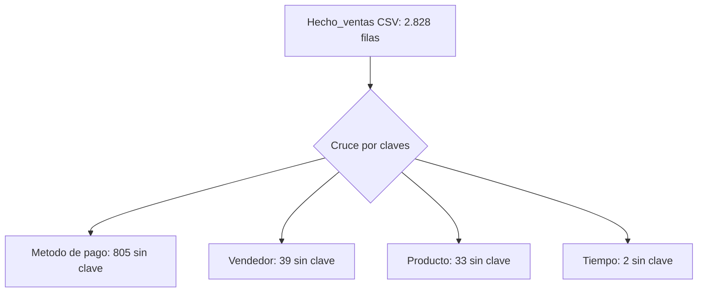

# Experimentación de SQL Server y ETL

> **Fuentes y límites de verificación.** El texto se basa en archivos aportados por el equipo. Las capturas de SSMS del informe Word provienen del documento de experimentación compartido; los diagramas de esta versión web son reconstrucciones. No se simulan capturas de Power BI Desktop ni de una ejecución SQL no realizada.

Pruebas de exportación, integridad de claves y consistencia de resultados

| Componente | Experimentación SQL |
| --- | --- |

Base de trabajo · Archivos adjuntos de DNX Cauchos S.R.L.

Evidencia · Archivos originales, metadatos PBIX y exportaciones CSV

### Alcance

Se describen los procedimientos y resultados sustentados en los archivos entregados. Los gráficos elaborados a partir de datos y los esquemas reconstruidos se identifican como tales; no se presentan como capturas de una sesión ejecutada en SQL Server o Power BI.

*Fuentes principales: Base de datos Transaccional DNX Cauchos SRL(1).sql, Base de datos Análitica DataMart DNX Cauchos SRL(1).sql, Base de datos proceso ETL DNX Cauchos SRL(1).sql, Experimentacion.docx, Hecho_ventas(1).csv, dim_metodoPago(1).csv, dim_tiempo(1).csv.*

## 1. Pregunta e hipótesis

¿La extracción y transformación permiten obtener datos utilizables sin perder integridad? La hipótesis de trabajo es que la conversión adecuada de textos evita problemas de codificación, y que una recarga consistente de dimensiones y hechos permite consultar los KPI sin pérdidas causadas por claves desalineadas.

## 2. Diseño de pruebas

| Prueba | Variable o contraste |
| --- | --- |

| E1 | VARCHAR frente a NVARCHAR |
| --- | --- |

| E2 | Volumen original frente a x400 | Comparación de cardinalidades de CSV |
| --- | --- | --- |

| E3 | Integridad entre hechos y dimensiones | Cruce de claves de CSV en Python |
| --- | --- | --- |

| E4 | Alineación de versiones | Comparación script transaccional (1) vs CSV grande |
| --- | --- | --- |

*Tabla 1. Diseño de la experimentación y fuentes usadas.*

## 3. Evidencia de la exportación

**Figura 1. Captura real proporcionada en Experimentacion.docx: selección de exportación en SSMS. Fuente: Documento del compañero**

*La captura original o el gráfico derivado se encuentra en la edición ilustrada del informe.*

La experimentación aportada comparó copia directa de VARCHAR con consultas que convierten textos a NVARCHAR. Reportó una validación fallida en la primera prueba y éxito al usar NVARCHAR con UTF-8; la opción x400 se empleó exclusivamente para simular mayor volumen en los archivos exportados.

**Figura 2. Captura real proporcionada: ventana de error en la validación de la exportación. Fuente: Documento del compañero**

*La captura original o el gráfico derivado se encuentra en la edición ilustrada del informe.*

| Caso | Configuración | Resultado documentado |
| --- | --- | --- |

| A | VARCHAR, x1 | Error de validación; 0 filas |
| --- | --- | --- |

| B | CAST a NVARCHAR, x1 | 11/11 acciones, 60 filas en ejemplo |
| --- | --- | --- |

| C | CAST a NVARCHAR y CROSS JOIN x400 | Éxito; 24,000 vendedores desde 60 originales |
| --- | --- | --- |

*Tabla 2. Síntesis de la experimentación ya documentada por el compañero.*

## 4. Auditoría independiente de los CSV

Se leyeron los CSV adjuntos tal como fueron exportados. En Hecho_ventas.csv se encontraron 2,828 registros, 2,828 pk_detalle distintos y 1,406 pk_venta distintos. Las cantidades y montos se sumaron desde los campos originales, sin imputar valores.

Indicador · Valor constatado

Detalles · 2,828

Ventas distintas · 1,406

Unidades · 256,705

Venta neta · S/ 4,816,594.00

Descuento total · S/ 70,370.00

Costo fabricación · S/ 4,518,247.50

Utilidad estimada · S/ 298,346.50

Margen · 6.19 %

*Tabla 3. Agregaciones reproducibles directamente sobre Hecho_ventas(1).csv.*

## 5. Prueba de integridad de claves

**Figura 3. Filas de hecho cuyos ID no existen en las dimensiones CSV correspondientes.**

Las cuatro dimensiones exportadas con ID subrogado comienzan en 2. Sin embargo, la tabla de hechos todavía contiene el valor 1 en algunas claves. Esto impide relacionar ciertas filas mediante igualdad simple y puede alterar el resultado de filtros en Power BI.

Dimensión · Filas de hechos sin correspondencia

dim_metodoPago · 805

dim_vendedor · 39

dim_producto · 33

dim_tiempo · 2

Con algún fallo en esas cuatro dimensiones (sin duplicar filas) · 857 de 2,828 (30.30 %)

*Tabla 4. Análisis de pertenencia entre claves del CSV de hechos y dimensiones.*

Limitación específica: dim_cliente.csv no conserva id_cliente, por lo que la integridad de esa relación no puede evaluarse con la exportación recibida. Las 857 filas con alguna clave faltante no equivalen a 857 ventas distintas.

## 6. Comprobación de procedencia de datos

El script transaccional (1) recibido contiene 75 identificadores de cliente, 12 de vendedor, 360 ventas y 470 detalles. Los CSV ampliados contienen 600 códigos únicos de cliente y 2,828 detalles; no pertenecen a una única carga reproducible del archivo transaccional (1). Esta diferencia debe declararse y corregirse si el profesor pide trazabilidad desde el origen hasta Power BI.

## 7. Repetición y corrección propuesta

Recrear el origen, Data Mart y ETL desde un mismo conjunto de scripts y datos, en una base de pruebas nueva.

Corregir el reinicio de IDENTITY para alinear claves con las cargas; registrar el conteo por tabla y sus rangos de claves.

Ejecutar consultas de antijoin para todas las dimensiones, confirmar 0 claves faltantes y comparar sumas con los KPI de Power BI.

Exportar nuevamente los seis CSV después de la validación y preservar una fecha de corte y hash para cada archivo.

-- Ejemplo para detectar hechos sin método de pago

`SELECT COUNT(*) AS sin_metodo`
`FROM dm_DNX_Cauchos_SRL.dbo.hecho_ventas h`
`LEFT JOIN dm_DNX_Cauchos_SRL.dbo.dim_metodoPago m`
`ON h.id_metodoP = m.id_metodoP`
`WHERE m.id_metodoP IS NULL;`
## 8. Conclusiones y evidencia pendiente

La extracción Unicode y el escalado x400 cuentan con evidencia en el informe del compañero. La auditoría de CSV detectó un problema distinto: claves de hechos sin correspondencia en la exportación analítica. El hallazgo no prueba que el SQL Server original estuviera incorrecto en el momento de la carga, porque faltan capturas y una exportación validada de esa misma ejecución.

Prueba por realizar: [Agregar captura auténtica de SSMS después de repetir ETL con 0 registros huérfanos y totales coincidentes].

## Anexo A. Registro de repetición de pruebas

Estas pruebas permiten convertir el hallazgo actual en una experimentación completa con comparación antes y después. Solo los resultados de la columna «Observado» están comprobados en las exportaciones adjuntas.

| Prueba | Observado en archivos | Pendiente de ejecutar |
| --- | --- | --- |

| Escalado x400 | 240,000 clientes; 24,000 productos; 24,000 vendedores | Verificar limpieza y unicidad en PySpark |
| --- | --- | --- |

| Claves IDENTITY | Dimensiones exportadas comienzan en 2; hechos incluyen 1 | Recrear ETL con RESEED correcto |
| --- | --- | --- |

| Duplicados de dimensiones | Cada clave de producto/vendedor se repite 400 veces en CSV | No usar CSV bruto como dimensión única en BI |
| --- | --- | --- |

| Integridad de cliente | CSV no tiene id_cliente subrogado | Exportar o reconstruir la correspondencia |
| --- | --- | --- |

| Datos de versiones | 470 detalles en script (1); 2,828 en CSV ampliado | Anotar versión y hash del origen |
| --- | --- | --- |
